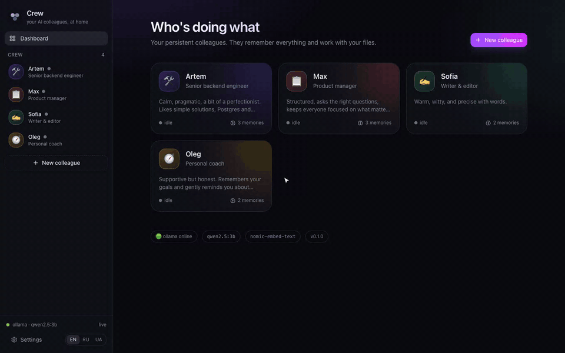
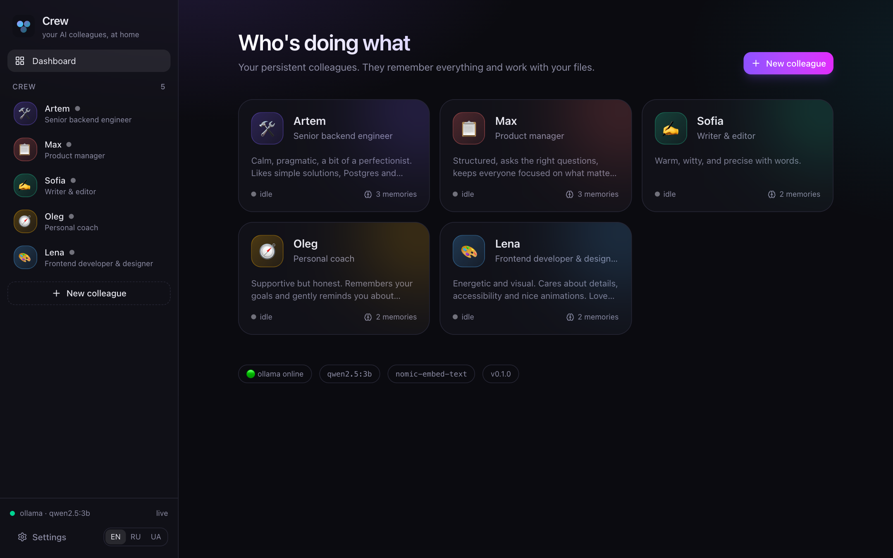
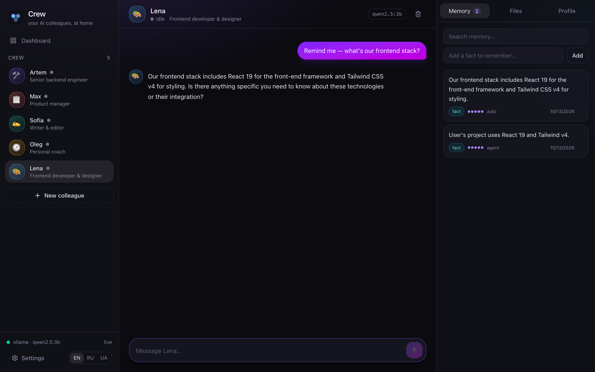
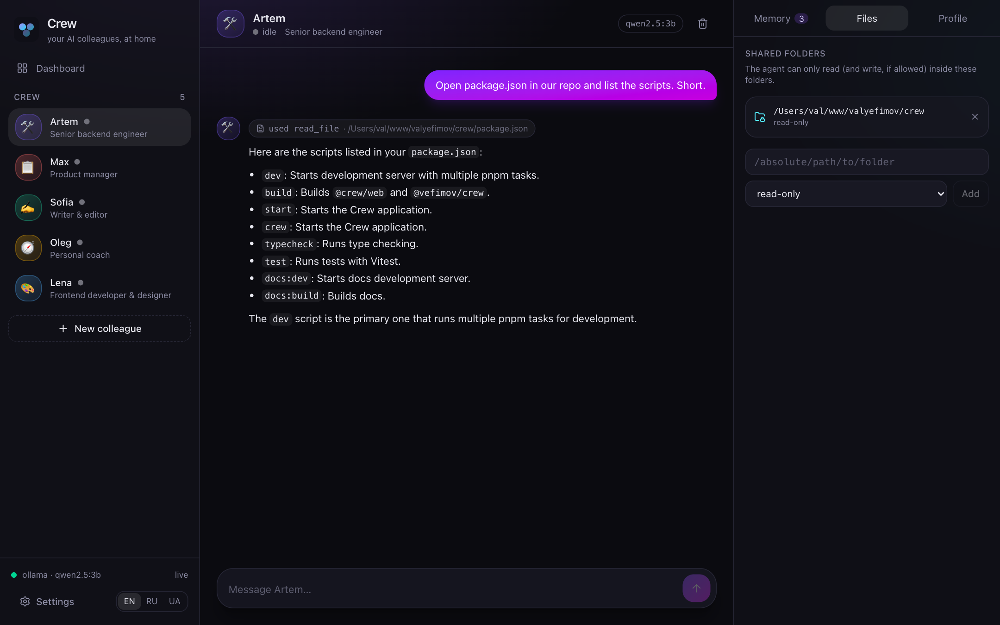
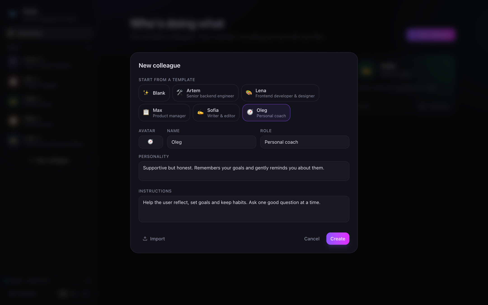
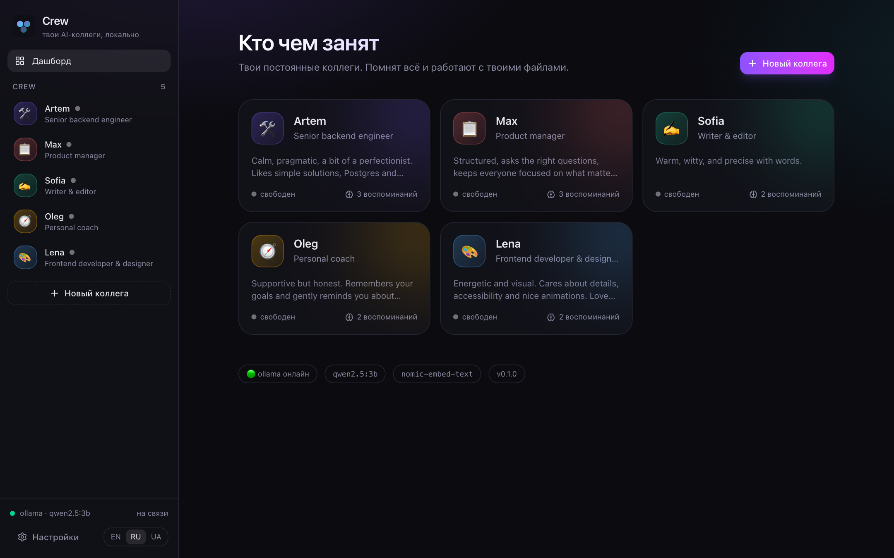
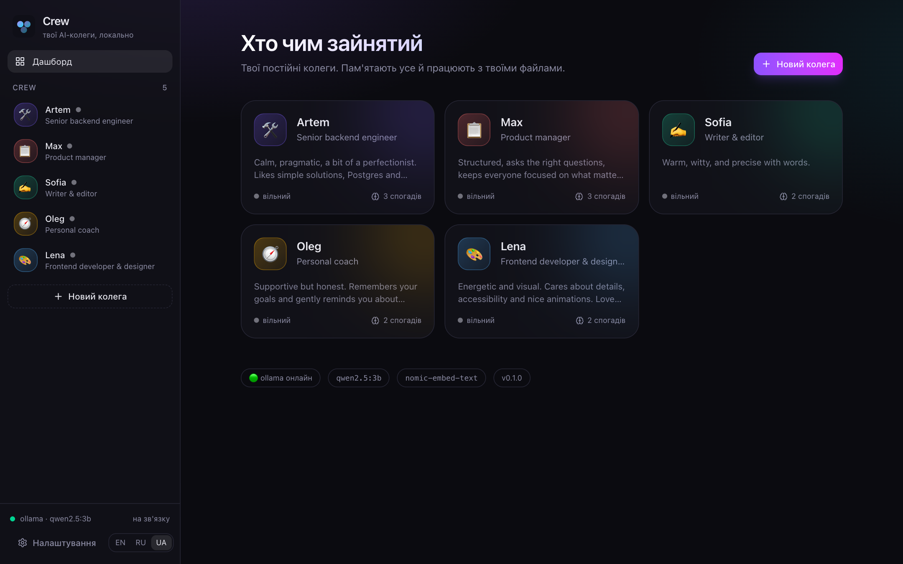
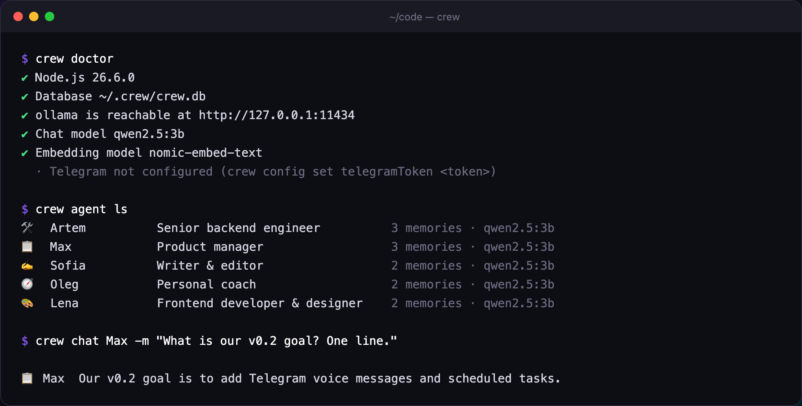

<div align="center">


# Crew

**Your AI colleagues, at home.**

A lightweight, local-first workspace where persistent AI agents live.
They remember everything, work with your files, and talk to you in the browser, the terminal and Telegram.

[](https://www.npmjs.com/package/@vefimov/crew)
[](https://github.com/valyefimov/crew/actions)
[](LICENSE)
[](.nvmrc)
[](#why-crew)

[**Docs**](https://valyefimov.github.io/crew/) ·
[Русский](https://valyefimov.github.io/crew/ru/) ·
[Українська](https://valyefimov.github.io/crew/uk/) ·
[Roadmap](https://valyefimov.github.io/crew/guide/roadmap)

```bash
npx @vefimov/crew
```

<br />

<a href="https://valyefimov.github.io/crew/media/demo.mp4">
  
</a>

**▶ Watch the 90-second demo with voice-over:**
[English](https://valyefimov.github.io/crew/media/demo.mp4) ·
[Русский](https://valyefimov.github.io/crew/media/demo-ru.mp4) ·
[Українська](https://valyefimov.github.io/crew/media/demo-uk.mp4)

</div>

---

## Why Crew

Most "AI assistants" are a chat box that forgets you the moment you close the tab. Crew is the opposite: a small team of **persistent colleagues** that live on your machine.

|   |   |
|---|---|
| 🏠 **Local-first** | Runs on [Ollama](https://ollama.com) (or any OpenAI-compatible server). One SQLite file. No cloud, no accounts, no telemetry. |
| 🧠 **Real memory** | Each agent keeps long-term facts, decisions and preferences. Hybrid full-text + vector search, auto-extracted after every chat. |
| 🎭 **Characters** | Name, role, personality, instructions, even a different model per agent. Start from templates: backend dev, designer, PM, writer, coach. |
| 📁 **Your files** | Share a folder read-only or read-write. Agents list, read and write files — symlink- and `../`-proof. |
| ✈️ **Telegram** | Paste a bot token, pair with a one-time code, chat with your crew from your phone. Memory is shared with the web UI. |
| 🌍 **Three languages** | UI and docs in English, Русский and Українська. |
| ⚡ **One command** | Web UI, CLI, REST + WebSocket API and a background worker — all in a single `npx`. |

## Screenshots

<table>
  <tr>
    <td width="50%"><br /><sub><b>Dashboard</b> — who's doing what, live</sub></td>
    <td width="50%"><br /><sub><b>Chat + memory</b> — browse and edit what an agent remembers</sub></td>
  </tr>
  <tr>
    <td width="50%"><br /><sub><b>Files</b> — shared folders and visible tool calls</sub></td>
    <td width="50%"><br /><sub><b>Templates</b> — hire a new colleague in seconds</sub></td>
  </tr>
  <tr>
    <td width="50%"><br /><sub><b>Русский</b></sub></td>
    <td width="50%"><br /><sub><b>Українська</b></sub></td>
  </tr>
</table>

<p align="center"></p>

## Quick start

You need **Node.js 22.13+** and **Ollama**:

```bash
ollama pull qwen2.5:3b
ollama pull nomic-embed-text

npx @vefimov/crew
```

Open <http://localhost:3000>, hire your first colleague, say hi. Close the tab, come back tomorrow — they still know who you are.

```bash
# or from the terminal
npm i -g @vefimov/crew
crew agent create Artem --template backend --folder ~/code/my-api
crew chat Artem
crew doctor               # check your setup
```

<details>
<summary><b>Docker</b></summary>

```bash
docker compose -f docker/docker-compose.yml up
docker compose -f docker/docker-compose.yml exec ollama ollama pull qwen2.5:3b
docker compose -f docker/docker-compose.yml exec ollama ollama pull nomic-embed-text
```

</details>

<details>
<summary><b>Telegram</b></summary>

```bash
crew config set telegramToken 123456:ABC...   # from @BotFather
crew start
# ✔ Telegram bot online — send /pair 482913 to it
```

`/agents`, `/use <name>`, `/memory`, `/forget` — or just address someone: *"Lena, how does this look?"*

</details>

<details>
<summary><b>Use a different model provider</b></summary>

LM Studio, llama.cpp, vLLM, OpenRouter, OpenAI — anything OpenAI-compatible:

```bash
CREW_PROVIDER=openai OPENAI_BASE_URL=http://127.0.0.1:1234/v1 crew start
```

</details>

## How it works

```
 Web UI ─┐
 CLI ────┼──▶ Crew runtime ──▶ Ollama / OpenAI-compatible
 Telegram┘        │  ▲
                  ▼  │ tools: remember · recall · list/read/write files
              SQLite (one file: chats, memories, vectors, queue)
                  │
                  ▼
          background worker ──▶ memory extraction, embeddings
```

- **No native dependencies** — uses Node's built-in `node:sqlite`, so `npx` just works.
- **Hybrid memory in SQLite** — FTS5 (BM25) + cosine over embeddings, fused with reciprocal-rank fusion, nudged by importance and recency. Near-duplicates are skipped.
- **Provider-agnostic** — a tiny `Provider` interface with streaming and tool calls.
- **Safe files** — paths are resolved with `realpath` *before* the permission check; writes need an explicit `rw` grant.

Read more in the [architecture docs](https://valyefimov.github.io/crew/guide/architecture).

## Repository

```
apps/server      Hono — REST + WebSocket
apps/web         React 19 · Vite · Tailwind v4
packages/core    agent runtime, providers, tools, worker
packages/memory  SQLite store, FTS5 + vectors, task queue
packages/channels  Telegram (grammY)
cli              `crew` — published as @vefimov/crew
docs             VitePress site (en · ru · uk)
```

```bash
git clone https://github.com/valyefimov/crew && cd crew
pnpm install
pnpm dev      # API :3001, web UI :5173
pnpm test
```

## Roadmap

- [x] **v0.1** — agents, memory, web UI, files, Ollama, CLI, Telegram, background tasks
- [ ] **v0.2** — local voice (Whisper.cpp + Piper/Kokoro), scheduled tasks, sandboxed commands
- [ ] **v0.3** — Slack, multiple workspaces, agents talking to each other
- [ ] **v1.0** — team mode, marketplace of characters and skills, PWA, plugins

## Security

Crew listens on `127.0.0.1` by default and its API has **no authentication**. Don't expose it to the internet without a reverse proxy that adds auth.

## License

[MIT](LICENSE) © Valentyn Yefimov
